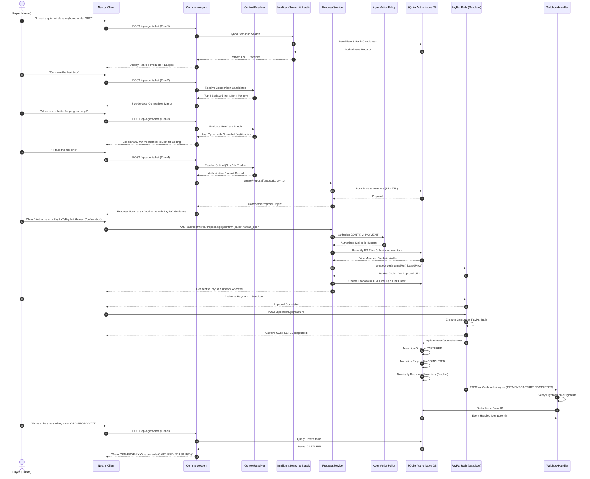

# PAYPAL AI HACKATHON — ARCHITECTURE & FOUNDATION SPECIFICATION
## Phase 1 & 2: Architecture & Core PayPal Integration

This document details the architectural boundaries, security constraints, payment rails, AI abstraction, data models, state machine, idempotency architecture, and error handling established during **Phase 1: Foundation & Architecture** and **Phase 2: Core PayPal Integration**.

---

## 1. System Overview & Core Philosophy

The primary objective of this architecture is to establish a **governed commerce platform** where an AI agent can analyze intent, recommend products, and propose transaction actions, but **NEVER possesses direct, unvalidated financial authority**. All financial transactions flow through a server-authoritative PayPal integration.

### Complete PayPal Payment & Webhook Lifecycle

```text
               ┌────────────────────────┐
               │    USER / CONSUMER     │
               └───────────┬────────────┘
                           │
                           ▼
               ┌────────────────────────┐
               │      FRONTEND UI       │
               │ (React / Next.js SSR)  │
               └───────────┬────────────┘
                           │
                           │  1. POST /api/orders (amount, currency, description)
                           ▼
               ┌────────────────────────┐
               │    CREATE ORDER API    │
               │   (Validation & Auth)  │
               └───────────┬────────────┘
                           │
                           │  2. createOrder(internalReference) + PayPal-Request-Id
                           ▼
               ┌────────────────────────┐
               │     PAYPAL SERVICE     │
               └───────────┬────────────┘
                           │
                           │  3. POST /v2/checkout/orders
                           ▼
               ┌────────────────────────┐
               │     PAYPAL SANDBOX     │
               └───────────┬────────────┘
                           │
                           │  4. Return Approval URL & Order ID
                           ▼
               ┌────────────────────────┐
               │      BUYER APPROVAL    │
               │  (Sandbox Checkout /   │
               │   Simulated Approval)  │
               └───────────┬────────────┘
                           │
                           │  5. POST /api/orders/[id]/capture
                           ▼
               ┌────────────────────────┐
               │      CAPTURE API       │
               └───────────┬────────────┘
                           │
                           │  6. POST /v2/checkout/orders/[id]/capture
                           ▼
               ┌────────────────────────┐
               │     PAYPAL SANDBOX     │
               └───────────┬────────────┘
                           │
                           │  7. Capture Details (ID, status, amount)
                           ▼
               ┌────────────────────────┐
               │  DATABASE PERSISTENCE  │
               │  (status: "CAPTURED",  │
               │   paypalCaptureId)     │
               └───────────┬────────────┘
                           │
                           │  8. POST /api/webhooks/paypal (Asynchronous)
                           ▼
               ┌────────────────────────┐
               │   WEBHOOK PROCESSOR    │
               │  (Signature Verified & │
               │     Deduplicated)      │
               └───────────┬────────────┘
                           │
                           ▼
               ┌────────────────────────┐
               │  FINAL VERIFIED STATE  │
               └────────────────────────┘
```

---

## 2. Layer Separation & Boundaries

The codebase strictly decouples concerns across these primary domains:

| Layer | Directory | Responsibilities | Security Boundaries |
| :--- | :--- | :--- | :--- |
| **Frontend UI** | `src/app/`, `src/components/` | Responsive UI, state management, UX states (`idle`, `creating_order`, `waiting_approval`, `capturing`, `payment_successful`, `payment_failed`, `payment_cancelled`, `payment_pending`, `network_error`). | **Client-side only**. Has ZERO access to PayPal client secrets or AI API keys. Communicates strictly with `/api/*`. |
| **API Endpoints** | `src/app/api/` | Route handlers, request/response lifecycle, parameter parsing, error normalization. | Enforces request correlation (`x-request-id`), input sanitization, and shields internal stack traces. |
| **AI Layer** | `src/server/ai/` | Intent understanding, product recommendations, draft order proposals. | **AI is NOT the authority**. AI proposals must pass schema parsing and Business Rule Validation before being authorized. |
| **PayPal Service** | `src/server/paypal/` | PayPal Sandbox client, OAuth2 token caching, order creation, capture, error normalization. | Server-side only. Enforces transaction limits ($1000 max), supported currencies (USD, EUR, GBP, CAD, AUD), and idempotency. |
| **Payment State Machine** | `src/server/paypal/state-machine.ts` | Enforces valid payment lifecycle states and transition guards. | Rejects backwards or illegal state transitions (e.g. `CAPTURED` -> `CREATED`). |
| **Precise Money Handling** | `src/server/paypal/money.ts` | Eliminates floating-point drift, enforces minor unit cents calculations and 2-decimal precision. | Rejects negative, NaN, Infinity, and currency manipulation. |
| **Webhooks** | `src/server/paypal/webhooks.ts` | Verification of PayPal cryptographic signatures, deduplication, and event processing. | Rejects untrusted webhooks. Validates transmission headers. Idempotency enforced via database event tracking. |
| **Database** | `src/server/db/` | Entity management, persistence, audit trails, and transactional integrity. | Keeps internal order references separated from external PayPal identifiers. |
| **Observability** | `src/server/observability/` | Structured JSON logging, correlation IDs, sensitive data masking. | Automatically redacts `secret`, `api_key`, `token`, `password`, `authorization` from all logs. |

---

## 3. Payment State Machine Specification

The system defines a formal finite state machine for every payment order:

```text
               ┌─────────────┐
               │   CREATED   │
               └──────┬──────┘
                      │
          ┌───────────┼───────────┐
          │           │           │
          ▼           ▼           ▼
   ┌─────────────┐ ┌─────────┐ ┌────────┐
   │  APPROVED   │ │CANCELLED│ │ FAILED │
   └──────┬──────┘ └─────────┘ └────────┘
          │
     ┌────┴────────────┐
     │                 │
     ▼                 ▼
┌──────────────┐ ┌──────────┐
│CAPTURE_PENDING│ │ CAPTURED │
└──────┬───────┘ └────┬─────┘
       │              │
       ▼              ▼
  ┌──────────┐   ┌──────────┐
  │  FAILED  │   │ REFUNDED │
  └──────────┘   └──────────┘
```

### Valid Transition Matrix

| Current State | Permitted Target States |
| :--- | :--- |
| `CREATED` | `APPROVED`, `CAPTURE_PENDING`, `CAPTURED`, `CANCELLED`, `FAILED` |
| `APPROVED` | `CAPTURE_PENDING`, `CAPTURED`, `CANCELLED`, `FAILED` |
| `CAPTURE_PENDING` | `CAPTURED`, `FAILED` |
| `CAPTURED` | `REFUNDED` |
| `FAILED` | *(Terminal state)* |
| `CANCELLED` | *(Terminal state)* |
| `REFUNDED` | *(Terminal state)* |

---

## 4. Multi-Tier Idempotency Architecture

To prevent duplicate charges, double captures, and replay attacks, idempotency is enforced at three distinct layers:

1. **Client Gateway Level (`PayPal-Request-Id`)**:
   Every mutating request (`/v2/checkout/orders` and `/v2/checkout/orders/{id}/capture`) attaches a unique `PayPal-Request-Id` header (derived from `internalReference` or `CAP_<orderId>`). PayPal Sandbox ensures that duplicate network requests with the same header return the identical response.

2. **Database Order Level**:
   Before initiating a PayPal order, `PayPalService.createOrder` queries `getOrderByInternalRef`. If an order with that reference already exists, the existing record is returned immediately without creating a new order on PayPal.
   Similarly, before capturing an order, `PayPalService.captureOrder` checks if `existingOrder.status === 'CAPTURED'`. If already captured, it returns the existing capture record with zero secondary side effects.

3. **Webhook Intake Level**:
   Incoming PayPal webhook event IDs (`WH-...`) are indexed in the `WebhookEvent` table with unique constraint enforcement. When a duplicate delivery is received, it is recorded as `DUPLICATE` and safely acknowledged without triggering duplicate business actions.

---

## 5. Precise Money & Currency Governance

To ensure mathematical precision and prevent financial abuse:
- All financial calculations are validated in `src/server/paypal/money.ts`.
- Values are converted to **integer minor units** (e.g. `$49.99` -> `4999` cents) to eliminate IEEE-754 floating-point drift.
- Decimal precision is strictly capped at 2 decimal digits for fiat currencies (`USD, EUR, GBP, CAD, AUD`). Input such as `49.999` is rejected as precision abuse.
- Amounts are bounded by `MAX_TRANSACTION_AMOUNT` ($1000 default).
- Non-numeric strings, negative amounts, `NaN`, and `Infinity` are rejected with HTTP 400.

---

## 6. Governed AI Execution Lifecycle

AI cannot directly initiate or execute payments. The execution follows this strict six-stage lifecycle:

```text
[ USER QUERY ]
      │
      ▼
[ PROMPT INJECTION GUARD ] ──── (Violation detected) ───► [ REJECT / ABORT ]
      │ (Pass)
      ▼
[ AI PROVIDER ] (MockAIProvider or GeminiProvider)
      │
      ▼
[ STRUCTURED RESPONSE ] (JSON Contract)
      │
      ▼
[ SCHEMA VALIDATION ] (Zod Parser) ─── (Malformed) ────► [ ERROR / AUDIT LOG ]
      │ (Valid)
      ▼
[ BUSINESS RULE VALIDATOR ]
  - Amount <= MAX_TRANSACTION_AMOUNT ($1000)
  - Currency in ALLOWED_CURRENCIES
  - Positive numeric amount
  - Action whitelist (recommend_product | prepare_order | inquire_info)
      │
      ├──── (Violations) ──► [ DOWNGRADE / REJECT ACTION ]
      │
      ▼ (Authorized)
[ PERSIST AUDIT LOG ] (AIAuditLog Table)
      │
      ▼
[ CLIENT APPROVAL PROPOSAL ] ──► [ USER CONFIRMS ] ──► [ PAYPAL SANDBOX ORDER ]
```

---

## 7. Webhook Event Handling & Supported Types

| Event Type | Trigger | System Behavior |
| :--- | :--- | :--- |
| `CHECKOUT.ORDER.APPROVED` | Buyer authorizes order on PayPal | Updates order status to `APPROVED`. |
| `PAYMENT.CAPTURE.COMPLETED` | Funds captured successfully | Updates order status to `CAPTURED`, stores `paypalCaptureId`. |
| `PAYMENT.CAPTURE.DENIED` | Capture rejected by processor | Updates order status to `FAILED`. |
| `PAYMENT.CAPTURE.REFUNDED` | Merchant or buyer processes refund | Updates order status to `REFUNDED`. |
| *Unsupported Events* | Miscellaneous PayPal webhooks | Signature verified, recorded in DB with status `IGNORED`, acknowledged cleanly with HTTP 200. |

---

## 8. Retry & Error Normalization Policy

| Error Category | Classification | Policy | Safe Code |
| :--- | :--- | :--- | :--- |
| **Validation Error** | Client 4xx | Reject immediately without retry. | `VALIDATION_ERROR`, `INVALID_AMOUNT`, `UNSUPPORTED_CURRENCY` |
| **Authentication Error** | Gateway 401 | Invalidate cached OAuth token, re-fetch access token, retry once. | `AUTHENTICATION_FAILURE` |
| **State Machine Violation** | Client 400 | Reject illegal transition without retry. | `INVALID_STATE_TRANSITION` |
| **Idempotent Timeout / 5xx** | Network / 504 | Retry once after 300ms backoff if request has `idempotencyKey`. | `PAYPAL_TIMEOUT`, `PAYPAL_RETRY_EXHAUSTED` |
| **Non-idempotent 5xx** | Gateway 500 | Do NOT retry blindly. Fail safely to prevent duplicate charges. | `PAYPAL_API_ERROR` |

---

## 9. Phase 3: AI Commerce Agent & Proposal Lifecycle

Phase 3 introduces an autonomous Conversational Commerce Agent grounded in a verified product catalog, intermediate proposals, and strict human authorization gates:

```text
                  USER QUERY
                      │
                      ▼
            COMMERCE INTENT ENGINE
   (SEARCH | COMPARE | RECOMMEND | PURCHASE | ORDER_STATUS)
                      │
                      ▼
           GROUNDED CATALOG SEARCH
   (Live DB Verification of Price & Inventory)
                      │
                      ▼
           COMMERCE PROPOSAL CREATED
    (Status: PENDING_CONFIRMATION, TTL: 15m)
                      │
                      ▼
           EXPLICIT HUMAN AUTHORIZATION
 (POST /api/commerce/proposals/:id/confirm, caller: human_user)
         [AI CALLERS BLOCKED WITH HTTP 403]
                      │
                      ▼
          RE-VERIFY PRICE & INVENTORY
  (Rejects on Price Mismatch or Out-of-Stock)
                      │
                      ▼
          EXISTING PAYPAL SERVICE
     (Order Creation -> Sandbox Approval -> Capture)
```

### Action Security Policy Tiers
- `READ_ONLY`: `SEARCH_PRODUCTS`, `VIEW_PRODUCT`, `COMPARE_PRODUCTS`, `ORDER_STATUS`. AI can execute directly.
- `LOW_RISK_VALIDATED`: `CREATE_PROPOSAL`. AI can draft an intermediate proposal.
- `FINANCIAL_USER_AUTH`: `CONFIRM_PAYMENT`. Strictly requires human user authorization. AI caller rejected with HTTP 403.
- `FINANCIAL_SERVER_ONLY`: `CREATE_PAYPAL_ORDER`, `CAPTURE_PAYMENT`, `REFUND_PAYMENT`. Reserved exclusively for backend rails.

---

## 10. Phase 4: Product Intelligence — Channel3

Phase 4 evolves catalog retrieval into an authoritative **Product Intelligence Layer**, ensuring the conversational commerce agent answers not merely "What products match?" but "Which product is best for this user and why?".

```text
       USER INPUT / INTENT / BUDGET / PREFERENCES
                          │
                          ▼
             INTELLIGENT SEARCH ENGINE
       (Query normalization, category mapping,
        synonym expansion, budget extraction)
                          │
                          ▼
            DATABASE CATALOG RETRIEVAL
         (Authoritative Grounded Inventory)
                          │
                          ▼
           PRODUCT ATTRIBUTE ENRICHMENT
      (Features, use cases, connectivity, specs,
         stock thresholds, composite quality)
                          │
                          ▼
        MULTI-FACTOR RANKING ENGINE (Weights)
      - Relevance (0.25)       - Feature Match (0.25)
      - Budget Fit (0.20)      - Use Case Fit (0.15)
      - Availability (0.10)    - Preferences (0.05)
                          │
                          ▼
           EXPLAINABLE EVIDENCE & BADGES
      - BEST MATCH      - BEST VALUE
      - BUDGET OPTION   - PREMIUM OPTION
      - Grounded "Why Recommended" Bullet Points
                          │
             ┌────────────┴────────────┐
             ▼                         ▼
   SIDE-BY-SIDE COMPARISON     ALTERNATIVE SUBSTITUTION
   - Direct spec matrix        - Out-of-stock fallback
   - Cheapest / Top-rated      - Budget ceiling fallback
   - Grounded tradeoffs        - Feature-aligned alternatives
```

### Multi-Factor Scoring Formula

The ranking engine computes a normalized composite score $S \in [0, 1]$ for every candidate product:

$$S = w_{\text{rel}} \cdot S_{\text{rel}} + w_{\text{feat}} \cdot S_{\text{feat}} + w_{\text{bud}} \cdot S_{\text{bud}} + w_{\text{use}} \cdot S_{\text{use}} + w_{\text{avail}} \cdot S_{\text{avail}} + w_{\text{pref}} \cdot S_{\text{pref}}$$

Where:
- $w_{\text{rel}} = 0.25$: Text relevance and query token coverage.
- $w_{\text{feat}} = 0.25$: Extracted technical feature overlap (e.g. bluetooth, mechanical, ANC).
- $w_{\text{bud}} = 0.20$: Budget fit:
  - $1.0$ if under budget
  - $0.9$ if within 10% of budget
  - $0.4$ if slightly over budget (10–25%)
  - $0.0$ if $>25\%$ over budget
- $w_{\text{use}} = 0.15$: Use case alignment (e.g. coding, office, travel, gaming).
- $w_{\text{avail}} = 0.10$: Stock availability ($1.0$ for `IN_STOCK`, $0.7$ for `LOW_STOCK`, $0.0$ for `OUT_OF_STOCK`).
- $w_{\text{pref}} = 0.05$: Explicit buyer preference alignment.

### Zero-Hallucination Comparison Engine
The comparison engine requires at least 2 and at most 5 product IDs. Prior to synthesizing any comparison row or advantage, it validates each ID against SQLite. Any missing ID immediately aborts with an unrecoverable validation error, guaranteeing language models cannot fabricate products or specifications.

---

## 11. Phase 5: Semantic Search — Elastic

Phase 5 establishes a production-grade, hybrid semantic search architecture integrating lexical BM25 retrieval, 64-dimensional dense vector embeddings, typo tolerance, domain synonym handling, and resilient fallback degradation.

```text
               USER NATURAL LANGUAGE QUERY
                            │
                            ▼
               QUERY NORMALIZATION & TYPOS
         (Levenshtein <= 2, Synonyms, Budget extraction)
                            │
                            ▼
               SEARCH PROVIDER ORCHESTRATOR
         ┌──────────────────┴──────────────────┐
         ▼                                     ▼
ELASTICSEARCH PROVIDER               MOCK SEARCH PROVIDER
 (Dense vector KNN + Multi-match)   (In-memory BM25 + Cosine sim)
         │                                     │
         └──────────────────┬──────────────────┘
                            ▼
               CANDIDATE HIT GENERATION
           (Lexical Score + Semantic Score)
                            │
                            ▼
          AUTHORITATIVE DATABASE REVALIDATION
       (Prisma SQLite Source of Truth: Excludes stale
        ghost items; overwrites with live DB prices)
                            │
                            ▼
          PRODUCT INTELLIGENCE MULTI-FACTOR RANKING
            (Badges, evidence, budget fit)
                            │
                            ▼
               COMMERCE AGENT / PROPOSAL
```

### Search Provider Abstraction

The search subsystem decouples retrieval mechanisms through the [`ProductSearchProvider`](file:///d:/PROJECT/PAYPAL/src/server/commerce/search/types.ts) interface:
- **`MockSearchProvider`**: In-memory, fully deterministic search engine for offline testing and development. Implements token-level BM25 scoring, dynamic Levenshtein typo correction, and 64-dimensional cosine vector similarity.
- **`ElasticsearchProvider`**: Official `@elastic/elasticsearch` client integration. Defines typed Elasticsearch mappings (`dense_vector`, `multi_match`, `bool` filters, and `knn`).
- **`SearchManager`**: Coordinates indexing, reindexing, and runtime fallback. If Elasticsearch is unreachable, down, or times out, it logs a warning and automatically degrades to `MockSearchProvider` with zero downtime.

### Deterministic 64-Dimensional Embedding

The [`MockEmbeddingProvider`](file:///d:/PROJECT/PAYPAL/src/server/commerce/search/embedding.ts) projects queries and product text into a 64-dimensional Euclidean unit vector ($L_2 = 1.0$):
- Maps domain concept clusters (keyboards, audio, mice, monitors, software, silence, wireless, ergonomics, gaming, travel) to specific dimensional sub-spaces.
- Uses FNV-1a hash projections for vocabulary outside explicit clusters.
- Guarantees 100% deterministic output: identical input text yields identical vectors; semantically similar phrases achieve cosine similarity $> 0.70$, while cross-category phrases remain $< 0.35$.

### Critical Data Authority & Staleness Protection

Under Rule #3 and Rule #23:
- **Elasticsearch is strictly non-authoritative**. It functions exclusively as an inverted search index.
- Every candidate returned by search is checked against Prisma SQLite:
  - If a product ID in the index does not exist in SQLite (e.g. deleted item), it is discarded immediately.
  - If a price in the index is stale (e.g. index says \$50, database says \$79.99), the authoritative database price strictly overwrites the index price.
  - Transaction proposals and PayPal orders are created exclusively from authoritative database fields.

---

## 10. Phase 6: PayPal Agent Context & APIMatic Architecture

Phase 6 introduces the **Agent Context & APIMatic Capability Layer**, empowering AI agents with strongly-typed API tool calling capabilities under strict server-side policy governance.

```text
                     ┌──────────────────────────────────┐
                     │         AI AGENT / USER          │
                     └─────────────────┬────────────────┘
                                       │
                         1. Request Context Snapshot
                                       ▼
                     ┌──────────────────────────────────┐
                     │       AGENT CONTEXT BUILDER      │
                     │  (Budget Bounded: <= 4000 chars  │
                     │   Max Tools: <= 10, Security)    │
                     └─────────────────┬────────────────┘
                                       │
                         2. Evaluates Intent Against
                                       ▼
                     ┌──────────────────────────────────┐
                     │       TOOL POLICY ENGINE         │
                     │  - Rejects AI on Financial Caps  │
                     │  - Enforces Human Confirmation   │
                     │  - Validates Caller Permissions  │
                     └─────────────────┬────────────────┘
                                       │
                         3. Schema Validation &
                            Anti-Prototype Pollution
                                       ▼
                     ┌──────────────────────────────────┐
                     │      TOOL INTENT VALIDATOR       │
                     └─────────────────┬────────────────┘
                                       │
                         4. Authoritative Execution
                                       ▼
                     ┌──────────────────────────────────┐
                     │      TOOL EXECUTION ENGINE       │
                     │  - Product Search (Hybrid)       │
                     │  - Side-by-Side Comparison       │
                     │  - Commerce Proposals            │
                     │  - SQLite DB Authority Check     │
                     │  - Sensitive Data Redaction      │
                     │  - AIAuditLog Persistence        │
                     └──────────────────────────────────┘
```

### APIMatic Modeling & Capability Layer
- **`MockAPIContextProvider`**: Implements 9 deterministic APIMatic-modeled capabilities (`products.search`, `products.compare`, `products.recommend`, `commerce.createProposal`, `commerce.getProposal`, `paypal.getOrder`, `paypal.createOrder`, `paypal.capturePayment`, `system.getHealth`).
- **`APIMaticProvider`**: Live integration adapter connecting to APIMatic APIs when configured, falling back gracefully to mock provider if credentials are not configured.
- **`AgentCapabilityRegistry`**: Centralized in-memory registry enforcing categories, risk levels (`READ_ONLY`, `LOW_RISK_WRITE`, `HIGH_RISK_WRITE`, `FINANCIAL`, `ADMINISTRATIVE`), and allowed caller types (`human_user`, `ai_agent`, `server_system`).

### The Core Financial Invariant
$$ \text{AI proposes} \longrightarrow \text{Server validates} \longrightarrow \text{Policy validates} \longrightarrow \text{Authoritative DB validates} \longrightarrow \text{Human confirms} \longrightarrow \text{PayPal executes} $$
AI callers can discover tools, search products, generate comparisons, and create non-binding commerce proposals. Under no circumstances can an AI caller execute captures, transfer balances, or bypass payment confirmation gates.

---

## 11. Phase 7: End-to-End Agentic Commerce Architecture

Phase 7 achieves full end-to-end integration, transforming the platform into a cohesive, conversational, multi-turn agentic commerce system with deterministic self-healing and zero financial leakage.

### End-to-End Sequence Diagram



### Contextual Resolution Architecture (`ContextResolver`)
The `ContextResolver` parses conversational history strictly from server-authoritative conversation memory and fresh database lookups:
- **Pronouns & Ordinals**: Translates phrases like `"the first one"`, `"second option"`, `"the cheaper one"`, and `"buy that"` into precise database product UUIDs.
- **Relative Comparisons**: Extracts candidate sets from the most recently surfaced turn for side-by-side advantage/tradeoff evaluations.
- **Use-Case Matching**: Identifies domain requirements (e.g., coding, travel, office) and matches hardware attributes (tactile switches, active noise cancellation).
- **Price Inquiries & Checkout Intent**: Matches queries like `"Show me the final price"` or `"Yes, buy it"`, binding them to the active pending proposal.

### Failure Handling & Resilience Matrix (Scenarios A–G)

| Scenario | Condition | System Defense & Recovery |
| :--- | :--- | :--- |
| **A: Price Changed** | Merchant updates price in DB after proposal generated | `PriceMismatchError` thrown at confirmation; transaction aborted; user prompted with updated price. |
| **B: Depleted Inventory** | Stock drops to 0 before checkout confirmation | `InventoryUnavailableError` thrown; proposal rejected; alternative products suggested. |
| **C: AI Capture Attempt** | AI model or caller attempts direct PayPal capture | Policy engine blocks with `UNAUTHORIZED_OPERATION` (403); zero financial execution. |
| **D: Duplicate Capture** | Network retry or concurrent capture requests | State machine and `PayPal-Request-Id` idempotency cache return cached capture response; zero double charge; zero duplicate inventory decrement. |
| **E: Duplicate Webhook** | PayPal re-delivers identical webhook event | Event deduplication via unique `eventId` constraint; returns `DUPLICATE` status; zero state corruption. |
| **F: Proposal Expired** | User confirms after 15-minute TTL has elapsed | Checked against authoritative timestamp; transitions proposal to `EXPIRED`; throws `ProposalExpiredError`. |
| **G: Prompt Injections** | Adversarial jailbreak, price tampering, credential dump | Multi-pattern injection guard intercepts turn; flags security violation; returns `POLICY_BLOCKED`. |

---

## 13. Phase 8: PayPal-Inspired Product UI & AG Grid Integration

Phase 8 elevates the platform from an API-driven proof-of-concept into a production-grade, fintech-inspired enterprise commerce portal.

### 13.1 Component Hierarchy & Data Flow

```text
                                HomePage (`src/app/page.tsx`)
                                              │
    ┌───────────────────────────┬─────────────┴─────────────┬───────────────────────────┐
    ▼                           ▼                           ▼                           ▼
Header.tsx            ProductCatalogGrid.tsx      CommerceAgentPanel.tsx       OrderFlowCard.tsx
- PP Logo             - AG Grid React v33+        - Multi-turn AI Copilot      - 5-stage Stepper
- Tab Switcher        - Custom Cell Renderers     - Product Suggestion Cards   - Sandbox Capture
- Status Badges       - Sort / Filter / Modes     - 15m Proposal Countdown     - Order Lookup
- Mobile Menu         - Multi-item Comparator     - PayPal Gold Buy CTA        - Clear Error UX
                                │                           │
                                ├───────────────────────────┘
                                ▼
                   ProductComparisonView.tsx (2 to 5 items)
                   - POST /api/products/compare
                   - Matrix of specs, advantages, tradeoffs
                                │
                                ▼
                   ProductDetailModal.tsx (Accessible Dialog)
                   - GET /api/products/[id]
                   - Authoritative hardware specs & metadata
                                │
                                ▼
                   SecurityAuditFeed.tsx
                   - GET /api/audit/ai
                   - Live real-time governance trail
```

### 13.2 PayPal Fintech Visual Language
The interface adopts an authentic PayPal fintech aesthetic communicating trust, security, and clarity:
- **Palette**:
  - PayPal Navy: `#001C64` (Deep authoritative contrast)
  - PayPal Core Blue: `#003087` (Primary brand blue)
  - PayPal Accent Blue: `#0079C1` (Highlights and active states)
  - PayPal Gold: `#FFC439` (Distinctive call-to-action buttons)
  - Surface Background: `#F5F7FA` (Crisp modern dashboard surface)
- **Visual Cues**:
  - Invariant Trust Badges (`Server Authoritative`, `Human Confirmation`, `AG Grid Enterprise`, `PayPal Sandbox`).
  - Accessibility ratings with numerical feedback (`★ 4.6 (128 reviews)`).
  - High-contrast stock level badges (Emerald `IN STOCK`, Amber `LOW STOCK < 10`, Rose `OUT OF STOCK`).

### 13.3 AG Grid Product Catalog Implementation
- **Module Architecture**: Powered by `ag-grid-react` v33+ and `@ag-grid-community/all-modules` via `ModuleRegistry.registerModules([AllCommunityModule])`.
- **Column Definitions**:
  1. `Product`: Name, SKU, category tag, and summary.
  2. `Category`: Clean uppercase badge.
  3. `Price`: Formatted currency string (`$XX.YY USD`).
  4. `Inventory`: Color-coded availability status.
  5. `Rating`: Visual stars + review count.
  6. `Intelligence`: Badges (`BEST MATCH`, `BEST VALUE`, `BUDGET OPTION`).
  7. `Actions`: Interactive buttons for `View Details`, `+ Compare`, and `Buy / Propose`.
- **Filtering & Sorting**: Instant multi-attribute search, category tabs, in-stock only toggle, sort by Price (Asc/Desc), Availability, or Relevance.
- **Selection Tray**: Floating bottom tray tracking selected items (2 to 5) with direct one-click handoff to side-by-side comparison.

### 13.4 Non-Authoritative Client Invariant
The frontend client is strictly treated as untrusted:
- **Zero Price Overrides**: Form fields or AG Grid row edits cannot alter unit prices. All proposals query the database directly.
- **Human Confirmation Gate**: Payment orders are not created until explicit user action triggers `POST /api/commerce/proposals/[id]/confirm`.
- **Injection Sanitization**: All copilot and search input passes through `checkPromptInjection` before processing.


